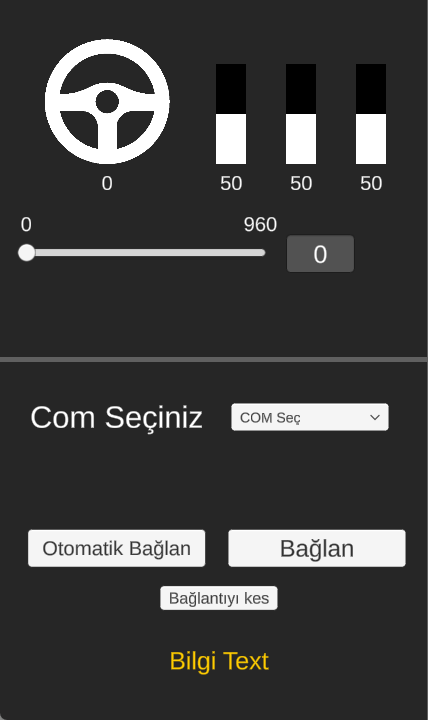
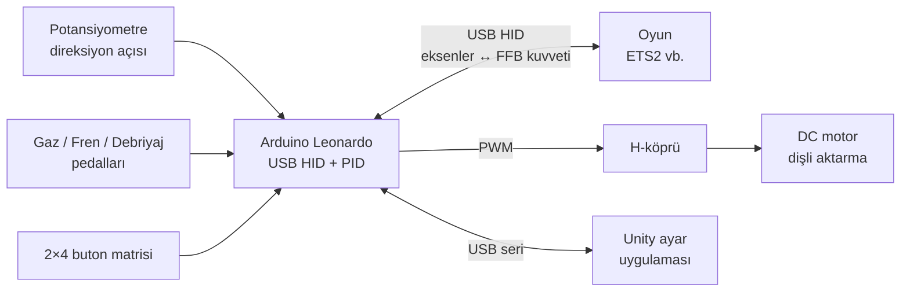

# 🏎️ Force-Feedback Direksiyon Seti

**Arduino ile kendi yaptığım, oyunlarda gerçek direksiyon gibi tanınan ve kuvvet geri bildirimi (FFB) veren direksiyon + pedal seti ve Unity ile yazılmış ayar uygulaması**

-00979D?logo=arduino&logoColor=white)
-blue)

## Proje hakkında
Piyasadaki FFB direksiyonlar pahalı olduğu için kendi direksiyon setimi tasarladım. Arduino Leonardo, USB üzerinden bilgisayara **HID oyun kumandası** olarak tanıtılıyor. Bu sayede Windows ve yarış oyunları (ör. Euro Truck Simulator 2) cihazı ek sürücü olmadan direksiyon olarak görüyor.

Oyunun gönderdiği kuvvet geri bildirimi komutları (USB HID PID) çözülüyor ve H-köprü üzerinden DC motora PWM olarak uygulanıyor. Böylece virajda ya da çarpışmada direksiyon gerçekten direnç gösteriyor.

## Özellikler
- **900° direksiyon:** Potansiyometre ile mutlak açı okunur, ayarlanabilir merkez ofseti vardır.
- **Kuvvet geri bildirimi:**
  - `Joystick.getForce()` ile oyundan gelen kuvvet okunur.
  - Ölü bölge filtresi uygulanır, ardından çift yönlü PWM motor sürüşü yapılır.
  - Yay (spring) efekti parametreleri gerçek zamanlı güncellenir.
- **Mekanik sınır koruması:** Direksiyon açı sınırını aşınca motor, direksiyonu güvenli aralığa geri iten bir kuvvet uygular.
- **3 pedal:** Gaz, fren ve debriyaj için ayrı eksenler ve her biri için kalibre edilmiş aralık.
- **8 buton:** 2×4 buton matrisi taraması (pull-up girişli).
- **1 kHz USB raporlama:** TIMER3 kesmesi (CTC modu) ile FFB raporları düzenli olarak işlenir.
- **Ayar uygulaması (Unity)**
  - Direksiyon açısını ve pedal doluluklarını canlı gösterir.
  - Maksimum direksiyon derecesini ayarlamayı sağlar.
  - Seri portları tarayıp `WHO_ARE_YOU` el sıkışmasıyla doğru Arduino'yu **otomatik bulur**.

## Mimari

## Nasıl denenir
- [Releases](../../releases) sayfasından ayar uygulamasını (`SteeringWheelSettings-Windows.zip`) indirip çalıştırabilirsin. Uygulama açılırken COM portlarını taradığı için ilk açılış birkaç saniye sürebilir.
- Herhangi bir oyun kumandası takılıysa direksiyon ve pedal göstergeleri o kumandanın eksenleriyle de hareket eder.
- Donanımı kurmak için [`showcase/firmware/ffbDireksiyon`](showcase/firmware/ffbDireksiyon) klasöründeki kodu bir Arduino Leonardo'ya ya da Pro Micro'ya [ArduinoJoystickWithFFBLibrary](https://github.com/YukMingLaw/ArduinoJoystickWithFFBLibrary) ile yükle.

## Kod örnekleri
- [`firmware/ffbDireksiyon/ffbDireksiyon.ino`](showcase/firmware/ffbDireksiyon/ffbDireksiyon.ino): HID tanımı, FFB kuvvet → PWM dönüşümü, sınır koruması, buton matrisi.
- [`unity/arduinoConnect.cs`](showcase/unity/arduinoConnect.cs): otomatik ve manuel seri port bağlantısı.
- [`unity/joyManager.cs`](showcase/unity/joyManager.cs): eksenlerin arayüze yansıtılması ve derece ayarı.

## Neler öğrendim
- USB HID ve PID (Physical Interface Device) raporlarının mantığı.
- AVR zamanlayıcı kesmeleri (TIMER3, CTC modu) ile düzenli görev çalıştırma.
- Motor sürüşünde ölü bölge, doyma ve güvenlik sınırları.

---
© Ahmet Emin Arslanbaş — Tüm hakları saklıdır. Kod inceleme amaçlı paylaşılmıştır.
